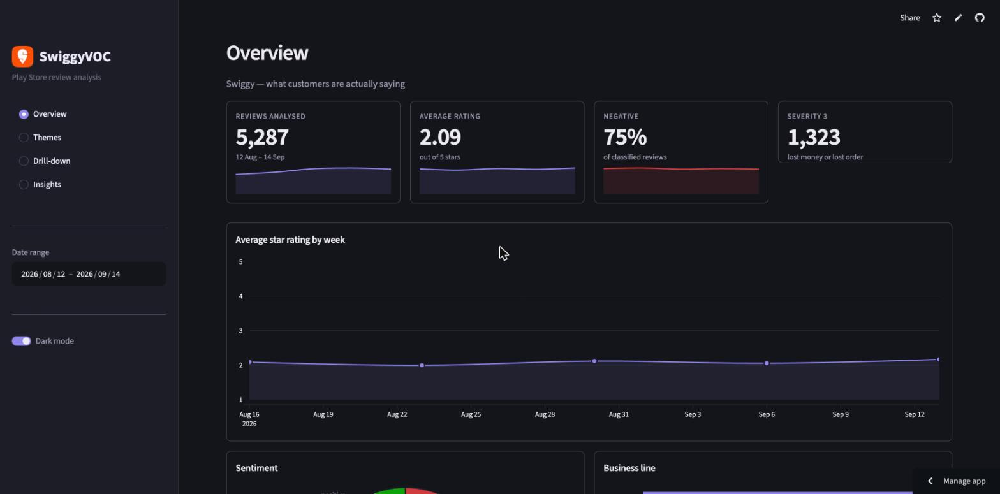

# SwiggyVOC: what Swiggy's customers are actually saying

**Live dashboard: [swiggyvoc.streamlit.app](https://swiggyvoc.streamlit.app)**

I scraped 15,000 Google Play Store reviews of the Swiggy app, sorted them into
product themes with an LLM, checked how reliable that sorting was, and ranked
the themes by how much harm they describe rather than how often they come up.



---

## Headline findings

Reviews from 12 August to 14 September 2026; 5,287 had enough text to analyse.
The full argument is in the [insights memo](docs/insights_memo.md).

1. **Volume points at the wrong problem.** Delivery timing is the second most
   common complaint (736 reviews) but only 12% describe losing money or an
   order. Missing orders are rarer (548) but **83%** are at the highest
   severity: the customer paid and got nothing.
2. **Customer support is the lowest-rated part of the experience** at
   **1.07 stars** across 747 reviews. In 75% of them, support is the whole
   complaint, not a side note. The chatbot is mentioned 124 times, and 99% of
   those mentions are negative.
3. **Nothing is getting worse, and that is a finding too.** Weekly theme shares
   barely move across five weeks. These are long-running problems, not a bad
   release, so they won't fix themselves.

**Recommendations:** make sure a human handles missing-order and refund cases,
refund undelivered items automatically below a value threshold, and stop
charging cancellation fees when Swiggy caused the failure. Delivery speed is
deliberately not first.

---

## How it works

```
Play Store ──► scrape.py ──► load_db.py ──► clean.py ──► classify.py ──► analysis.py ──► Streamlit
 15,000 reviews   CSV         SQLite        5,287 kept    Claude Haiku 4.5   SQL → CSVs     dashboard
                                                              │
                                              evaluate.py ◄───┘  checked against 200 reference labels
```

| Step | Script | What it does |
|---|---|---|
| 1. Scrape | `src/scrape.py` | Downloads the newest 15,000 Swiggy reviews with `google-play-scraper`. No usernames or profile pictures are kept. |
| 2. Store | `src/load_db.py` | Loads them into SQLite (`data/swiggy_reviews.db`). Safe to re-run; it never duplicates. |
| 3. Clean | `src/clean.py` | Flags reviews too short or generic to analyse ("good", emoji only, duplicates). Nothing is deleted. Hindi and Hinglish are kept as written. |
| 4. Taxonomy | `src/sample_for_labeling.py` | Draws a 400-review sample to design the [12 themes](docs/taxonomy.md), and a *separate* 200-review sample for grading, so the test isn't marked against its own homework. |
| 5. Classify | `src/classify.py` | Claude Haiku 4.5 assigns themes, sentiment, business line and a 1–3 severity, returned as structured JSON. Resumable, supports `--limit` test runs and prints its estimated cost. |
| 6. Evaluate | `src/evaluate.py` | Compares Haiku's labels with the reference set and writes [the evaluation](docs/evaluation.md). |
| 7. Analyse | `src/analysis.py` + `sql/queries.sql` | All aggregation is done in SQL and exported to `data/outputs/`. |
| 8. Dashboard | `app/streamlit_app.py` | Reads only the CSVs, never the database or the API, so it is safe to host publicly. |
| 9. Memo | `src/memo_figures.py` | Calculates every memo figure the main analysis does not, so each claim traces to a file. |

### The impact score

Ranking by complaint count rewards whatever is most common. Instead, each theme
is scored as:

> **impact = share of reviews × share negative × thumbs-up factor × average severity**

That way a rarer problem that costs people money can outrank a frequent one
that is just annoying.

---

## How reliable is the classification?

| Measure | Score |
|---|---|
| Sentiment agreement | 94.5% |
| Business line agreement | 77.5% |
| Severity agreement | 74.5% |
| Theme F1 (micro / macro) | 0.83 / 0.77 |

**Read these honestly.** The 200 reference labels were produced by Claude
Opus 5 and spot-checked by hand on a random 20. They were not written by a
person from scratch. So these numbers measure **how well a small, cheap model
agrees with a larger one**, not accuracy against human judgement. The
classifier also tends to miss themes rather than invent them (high precision,
lower recall), so theme counts are more likely too low than too high. Details
are in [docs/evaluation.md](docs/evaluation.md).

---

## Limitations

- **Five weeks of data.** Seasonality and festival peaks are invisible.
- **The sample leans negative by design.** Short reviews, which cleaning
  removed, are mostly praise: kept reviews average 2.09 stars and discarded
  ones 4.38. "75% negative" describes people who explained themselves, not
  Swiggy's customers overall.
- **Play Store reviewers are not a random sample of customers.** This
  complements in-app satisfaction and contact-rate data; it does not replace
  them.

---

## Run it yourself (macOS)

```bash
git clone https://github.com/azygit/swiggy-voc-analyzer.git
cd swiggy-voc-analyzer
python3 -m venv .venv
source .venv/bin/activate
python3 -m pip install -r requirements.txt
```

**Just the dashboard.** This needs no API key, because the results are already
in `data/outputs/`:

```bash
streamlit run app/streamlit_app.py
```

**The full pipeline.** Copy `.env.example` to `.env`, put your Anthropic API
key in it, and run each step from the project root:

```bash
python3 src/scrape.py --count 200     # small test first; drop --count for 15,000
python3 src/load_db.py
python3 src/clean.py
python3 src/sample_for_labeling.py
python3 src/classify.py --limit 40    # check the cost estimate before a full run
python3 src/classify.py
python3 src/evaluate.py
python3 src/analysis.py
python3 src/memo_figures.py
```

---

## Project layout

```
app/streamlit_app.py      the dashboard
src/                      one script per pipeline step
sql/queries.sql           every analysis query, readable on its own
data/outputs/             the CSVs the dashboard reads (committed)
data/labels/              the reference and discovery samples
docs/taxonomy.md          the 12 themes and how each is defined
docs/evaluation.md        classifier vs reference labels, theme by theme
docs/insights_memo.md     findings and recommendations
```

Raw scraped data, the SQLite database and the `.env` file holding the API key
are deliberately not in the repository.

---

**Tech:** Python · pandas · SQLite · Anthropic API (Claude Haiku 4.5) · Streamlit · Plotly · google-play-scraper

Built by Ajay Patil. This is an independent portfolio project, not affiliated
with Swiggy.
